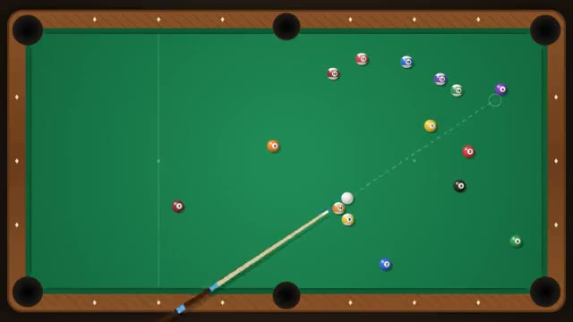

# Pool Hall

Solids or stripes. Clear your seven, then sink the 8. A multiplayer starter game from [Multiplayer Agent](https://multiplayeragent.com): 2D, turn-based, 2–4 players, with bots that fill empty seats.

## How it plays

Take turns on one felt table: drag back to aim and set power, let go to shoot. Pot a ball of your group to shoot again; a foul (scratch, wrong ball first, no cushion) gives the other side ball in hand. Sink the 8 last to win. Three or four players split into two teams and rotate.

**Controls:** Drag back from anywhere to aim and set power, let go to shoot (mouse or finger). With ball in hand, drag the white ball to place it first. The spin button picks follow or draw. Arrow keys fine-tune the aim, Space shoots.

## Make it yours in the Game Builder

Open the [Game Builder](https://multiplayeragent.com), choose **Start from a starter game** and pick Pool Hall. It opens as version 1 in your studio, ready to play and publish. Then ask for changes, for example:

- Add a trick-shot mode with a target zone on the table
- Make it a neon space table with glowing balls
- Add a shot clock that gets shorter every turn

## Run it yourself

1. Get a free publishable key (`pk_…`) at [multiplayeragent.com](https://multiplayeragent.com).
2. In `index.html`, put it in place of `pk_REPLACE_ME` in the `MP_CONNECT` block.
3. Open `index.html` in a browser. No build step and no server needed.

Without a key it still runs, offline against bots.

## How it is built

- One `index.html`. The comment at the top of the script maps the code and explains the multiplayer.
- **Leaderboard:** Most wins, shown on the results card.
- **Host-run physics:** The host's browser runs every shot and applies the rules; if it leaves, the next player takes over.
- **Bots:** Bots shoot in the empty seats, and take over for anyone who leaves.
- **Live sync:** Everyone sees the shooter's cue move and the same roll, ball for ball.
- `?attract` runs it offline with bots only. The preview video is recorded from it.

## License

MIT.
